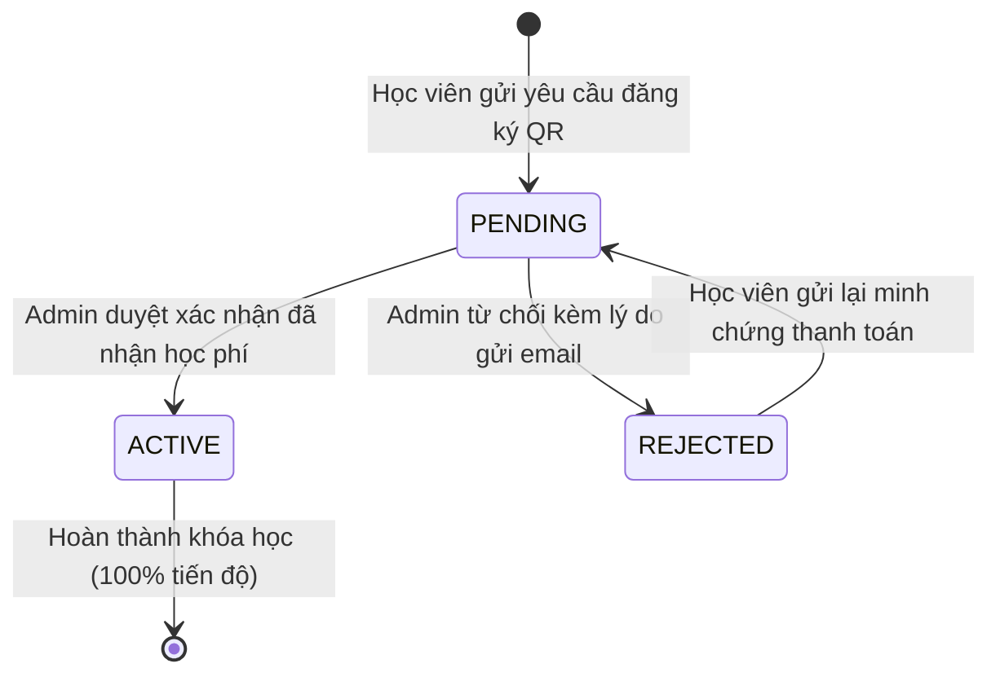
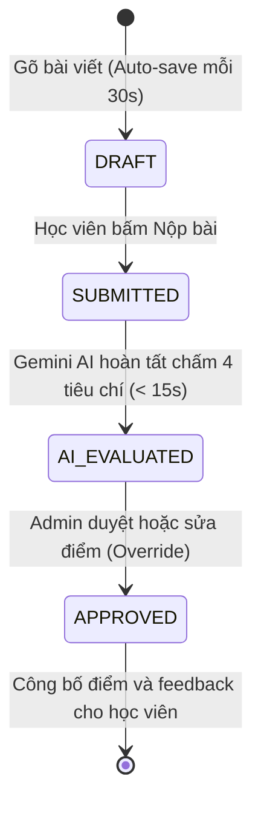
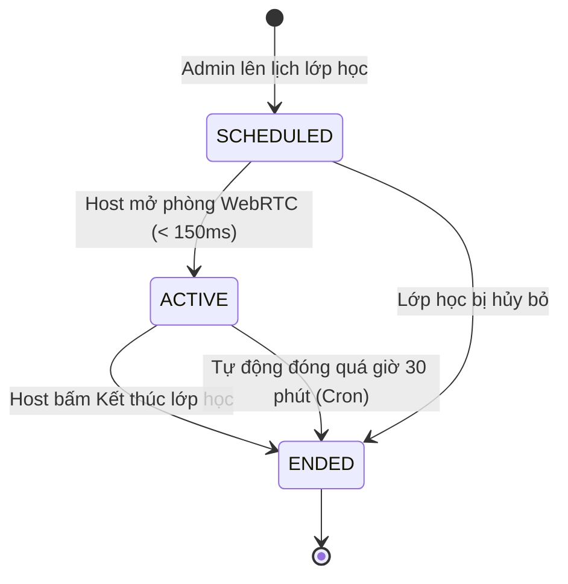
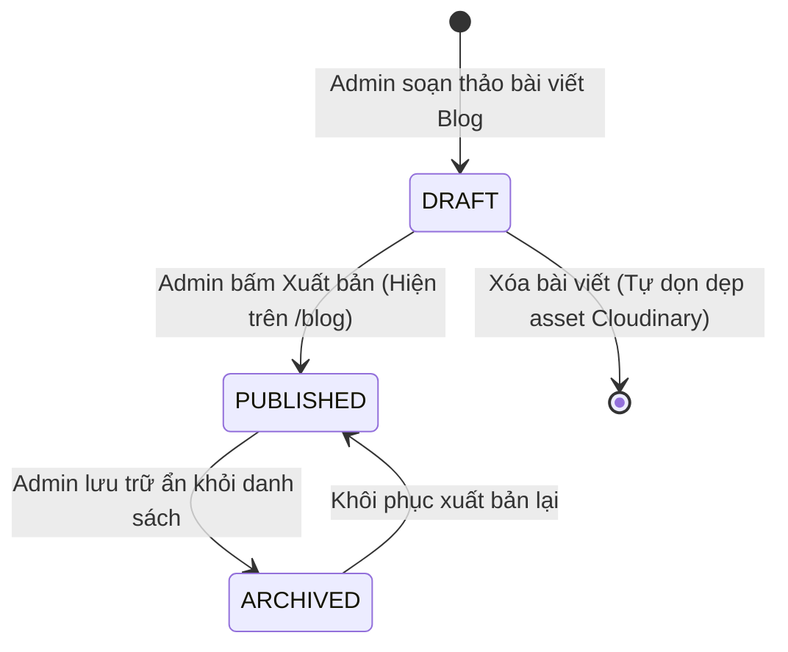

# TÀI LIỆU ĐẶC TẢ YÊU CẦU NGHIỆP VỤ PHẦN MỀM (SRS)
## HỆ THỐNG ĐÀO TẠO TRỰC TUYẾN CHUẨN EDTECH — TEACHER DONG ACADEMY
### Quy Chuẩn Đặc Tả BA Doanh Nghiệp Toàn Diện (7 Phần Từ A Đến G - Khớp 100% Codebase)

---

## 0. PHẦN ĐẦU: THÔNG TIN ĐỊNH DANH & CĂN CỨ (METADATA)

### 0.1. Thông Tin Định Danh Tài Liệu
* **Mã chức năng (ID)**: `TDA-SRS-MASTER-001`
* **Tên hệ thống (Title)**: Teacher Dong Academy – Nền tảng Đào tạo Trực tuyến, Luyện thi IELTS Đa Kỹ Năng & Lớp Học LiveKit SFU WebRTC
* **Tác giả (Owner)**: Lead Business Analyst & Solution Architect Team
* **Phiên bản (SRS Version)**: `3.0.0-COMPLETE-RELEASE`
* **Trạng thái (Status)**: `APPROVED`
* **Ngày tạo / Cập nhật**: 19/11/2026

### 0.2. Căn Cứ Viết Tài Liệu (Document Basis)
1. **User Requirement Document (URD)**: Yêu cầu nghiệp vụ số hóa trung tâm đào tạo tiếng Anh & Kỹ năng sống Teacher Dong.
2. **Interactive Prototype UI/UX**: Bản thiết kế giao diện động tương tác tại `docs/mock_test.html`.
3. **Đặc tả Chi tiết Màn hình & Dữ liệu**: `docs/Teacher_Dong_Academy_Chi_Tiet_Dac_Ta.md`.
4. **Đặc tả Kỹ thuật RESTful API & WebSocket**: `docs/API_DOCUMENTATION.md` (Swagger UI: `http://localhost:3001/api/docs`).
5. **Hiện trạng Mã Nguồn Thực Tế (Source of Truth)**:
   * Backend: 14 business modules, 7 core infrastructure modules, 22 Prisma Models tại `server/src/`.
   * Frontend: 34 màn hình Next.js 14 App Router tại `client/src/app/`, hệ thống modal drawers, whiteboard canvas và web audio recorder.
6. **Chuẩn Mã Thông Báo**: Hệ thống mã định danh chuẩn doanh nghiệp tiền tố `VDBAS-` kết hợp `ErrorCodesEnum` backend.

---

## PHẦN A — BẢNG ĐẶC TẢ CHỨC NĂNG (FUNCTIONAL SPECIFICATIONS)

### A1. Thông Tin Chung & Ma Trận 17 Phân Hệ Nghiệp Vụ Cốt Lõi
* **Đối tượng sử dụng (Actors)**:
  1. `STUDENT`: Học viên đã đăng ký tài khoản (học bài, làm quiz, nộp writing/speaking, vào lớp trực tuyến, xem chẩn đoán radar, quản lý phiên).
  2. `ADMIN`: Chủ sở hữu kiêm Giáo viên toàn quyền (quản trị khóa học, duyệt học phí, chấm bài, host lớp học, quản lý người dùng, phát thông báo).
* **Mục đích nghiệp vụ**: Giải quyết bài toán đào tạo tiếng Anh và kỹ năng toàn diện không phụ thuộc phần mềm bên thứ 3 (Zoom, Google Meet), bảo vệ bản quyền tài liệu số chống quay chụp màn hình, tự động hóa chấm điểm và kiểm soát chuyên cần bằng công nghệ AI và WebRTC.

#### Bảng Tổng Hợp Đặc Tả 17 Phân Hệ Chức Năng (FR-01 đến FR-17):

| Mã Phân Hệ | Tên Phân Hệ | Chi Tiết Nghiệp Vụ Cốt Lõi Khớp 100% Codebase |
|---|---|---|
| **FR-01** | **Xác thực, Phiên Đơn & Hồ Sơ Cá Nhân** | - Đăng ký, Đăng nhập email/mật khẩu.<br>- **Rate Limit chống Brute-force**: `@Throttle({ default: { limit: 5, ttl: 60000 } })`.<br>- **Single Concurrent Session**: Thu hồi token cũ khi đăng nhập thiết bị mới (`revokedAt = now()`), kích hoạt lưu nháp khẩn cấp `isEmergencySave: true`.<br>- **Google OAuth 2.0**: Đăng nhập, Liên kết (`/google/link`), Hủy liên kết (`/google/unlink` - chỉ cho phép khi đã có mật khẩu nội bộ).<br>- **Quên & Đổi mật khẩu**: Quên mật khẩu qua email SMTP; Đổi mật khẩu hỗ trợ **xác thực OTP qua Email** (`POST /api/auth/change-password/request-otp`).<br>- **Quản lý Phiên đa thiết bị**: Drawer xem danh sách phiên (IP, thiết bị, thời gian), thu hồi từ xa (`DELETE /sessions/:id`), đăng xuất tất cả (`POST /logout-all`).<br>- **Account Profile**: Xem thông tin (`/me`), sửa họ tên, SĐT (`PUT /profile`), tải ảnh đại diện Avatar lên Cloudinary (`POST /avatar`). |
| **FR-02** | **Đa Ngôn Ngữ (i18n)** | Hỗ trợ 5 ngôn ngữ (`VI`, `EN`, `ZH`, `JA`, `KM`), tự động nhận diện ngôn ngữ trình duyệt, nhớ cookie/localStorage, đồng bộ vào cơ sở dữ liệu `User.preferredLang`. |
| **FR-03** | **Quản Lý Đào Tạo & Duyệt Học Phí** | - Cấu trúc 4 cấp: Course ➔ Module ➔ Lesson ➔ Components.<br>- Quản lý 5 trụ cột đào tạo, tính % tiến độ, bài học học thử miễn phí (`isFreePreview`).<br>- Kéo-thả sắp xếp thứ tự Module & Lesson (`modules/reorder`, `reorder`).<br>- Tải video bài giảng lên Cloudinary (`POST /lessons/:id/video`).<br>- **Quy trình Duyệt Học Phí**: Học viên gửi yêu cầu chuyển khoản QR kèm `paymentNote` và `paymentAmount` (`POST /enroll-request`). Admin duyệt (`approve`) kích hoạt `ACTIVE`, hoặc từ chối (`reject`) kèm lý do gửi mail tự động.<br>- **Admin Ghi danh Thủ công**: Thêm học viên trực tiếp (`POST /courses/admin/manual-enroll`).<br>- **IELTS Paywall**: Kiểm tra điều kiện mở khóa cổng IELTS Hub (`GET /courses/ielts-access`) yêu cầu sở hữu khóa tiếng Anh. |
| **FR-04** | **Kho Học Liệu Số & Media CDN** | - PDF Viewer & Audio Player trực tiếp.<br>- Presigned URL 15 phút kèm cơ chế thu hồi tức thì qua **Redis Blacklist** khi tài liệu bị ẩn/xóa.<br>- **Dynamic Watermark**: Lớp phủ Canvas hiển thị Họ tên + SĐT + Mã học viên + Giờ thực trôi dạt tọa độ ngẫu nhiên mỗi 12-15s.<br>- Chặn click chuột phải (`contextmenu`), chặn phím tắt lưu file (`Ctrl+S`, `Ctrl+P`, `Ctrl+U`).<br>- Tải tệp học liệu nhị phân thật (`POST /materials/upload`), stream inline nhị phân thật (`GET /materials/:id/stream?token=...`).<br>- Bộ điều khiển Media Cloudinary trung tâm (`/api/media`): upload ảnh/video theo folder và xóa asset theo `publicId`. |
| **FR-05** | **Lớp Học WebRTC LiveKit & Bảng Trắng** | - Phòng học LiveKit SFU (1 Host + 7-8 Học viên), độ trễ < 150ms.<br>- Grid camera thông minh, bật/tắt mic/cam, giơ tay, chia sẻ màn hình.<br>- **Quyền Host**: Tắt mic từ xa, **Kick học viên vi phạm** (`POST /api/livekit/kick-participant`), phân quyền vẽ bảng trắng.<br>- **Bảng trắng 2 chiều (Whiteboard)**: 7 công cụ vẽ (bút, dạ quang, tẩy, hình hộp, tròn, mũi tên, văn bản), đồng bộ DataChannel, tự động dọn dẹp RAM khi đóng phòng.<br>- **Lịch sử phòng học**: Xem lịch sử lớp học cho Admin (`/livekit/admin/history`) và Học viên (`/livekit/student/history`).<br>- Tác vụ nền tự động đóng phòng học quá giờ 30 phút. |
| **FR-06** | **Luyện Viết IELTS Writing AI & Ngân Hàng Đề** | - Task 1 & Task 2, bộ đếm từ thời gian thực, đồng hồ đếm ngược.<br>- **Bản nháp tự động**: Lưu định kỳ mỗi 30s vào `WritingDraft`, lưu khẩn cấp khi mất mạng/ngắt phiên (`isEmergencySave: true`).<br>- AI Gemini chấm 4 tiêu chí (TR, CC, LR, GRA), gợi ý từ C1/C2, tự động sinh bài mẫu Band 8.5+ tức thời (`sampleBand8Essay`).<br>- **Human-in-the-Loop**: Kết quả ở trạng thái `AI_EVALUATED`, Admin sửa điểm (override), bổ sung nhận xét sư phạm và phê duyệt (`approve`).<br>- **Ngân hàng đề độc lập**: Màn hình quản trị `/admin/writing-prompts`, CRUD đề bài độc lập không bắt buộc gắn bài học. |
| **FR-07** | **Luyện Nói IELTS Speaking & Ngân Hàng Đề** | - Thu âm Web Audio API hiển thị sóng âm thời gian thực, đồng hồ bấm giờ (min 30s - max 120s), nghe audio phát âm mẫu bản xứ (`sampleAudioUrl`).<br>- Hỗ trợ nộp bài ghi âm tải trực tiếp lên Cloudinary (`POST /speaking/submissions/with-audio`).<br>- Admin chấm thủ công 4 tiêu chí (FC, LR, GRA, PR), tua +/- 5s, tốc độ 0.75x-2x.<br>- **Timestamp Comments**: Gắn nhận xét tại từng mốc giây audio, click tự động nhảy tới giây nhận xét.<br>- **Ngân hàng đề độc lập**: Màn hình quản trị `/admin/speaking-prompts`, CRUD đề bài nói độc lập. |
| **FR-08** | **IELTS Mock Test, Quiz 18 Dạng & Chẩn Đoán Radar** | - Hỗ trợ **18 dạng câu hỏi chuyên sâu** chuẩn Cambridge IELTS (Single, Multiple, Fill Blank, True/False/Not Given, Yes/No/Not Given, Matching Headings, Summary Completion, Note/Form/Map Labeling, Flowchart...).<br>- Bài đọc dài (`passage`), audio nghe (`audioUrl`), phân loại 4 cấp độ: `LESSON_QUIZ`, `PRACTICE_TEST`, `FULL_MOCK_TEST`, `DIAGNOSTIC_TEST`.<br>- Tự động chấm tức thì, sàn đạt $\ge 80\%$ để mở bài tiếp theo.<br>- **Bulk Question Import**: Thêm hàng loạt câu hỏi vào đề thi (`POST /quizzes/:id/questions/bulk`).<br>- **Hệ thống Chẩn đoán Năng lực 4 Kỹ năng**: Báo cáo phân tích điểm mạnh, điểm yếu theo từng dạng câu hỏi và Biểu đồ Radar cho học viên (`/diagnostic/me`) và toàn học viện (`/diagnostic/admin/overview`). |
| **FR-09** | **Điểm Danh Tự Động & Báo Cáo Chuyên Cần** | - Webhook LiveKit Idempotency đảm bảo bằng `event.createdAt` và composite key `(roomName, identity, joinedAt)`.<br>- Phân loại tự động: `PRESENT` (vào 15p đầu & $\ge 80\%$ thời lượng), `LATE` (vào sau 15p), `ABSENT` (< 30%).<br>- Admin can thiệp thủ công có ghi chú lý do (`override` + `note`), điểm danh cưỡng bức (`mark`).<br>- Xuất báo cáo Excel (.xlsx) theo buổi học hoặc theo khoảng ngày/khóa học (`/attendance/export`). |
| **FR-10** | **Dashboard & Student IELTS Master Hub** | - Dashboard Học viên: Tiến độ học tập, lịch học sắp tới, bài tập cần nộp, kết quả điểm gần nhất.<br>- **Student IELTS Master Hub** (`/student/ielts`): Thiết lập Target Band, biểu đồ Radar 4 kỹ năng, phân tích lỗi sai và lối tắt luyện tập.<br>- Dashboard Admin: Tổng số học viên, bài tập chờ duyệt, biểu đồ chuyên cần, tự động quét đóng phòng học cũ. |
| **FR-11** | **Nhắn Tin Thời Gian Thực (Chat)** | Kênh trò chuyện trực tiếp 1-1 giữa Admin và Học viên qua Socket.IO, lưu trữ DB (`Conversation`, `Message`), hiển thị `typing indicator` và `read receipts` tick xanh kèm timestamp `readAt`. |
| **FR-12** | **Quản Trị Blog & Media Cloudinary** | Cổng tin tức học thuật (`/blog`, `/blog/[slug]`), Admin quản trị toàn quyền (`/admin/blogs`: DRAFT, PUBLISHED, ARCHIVED), lưu trữ ảnh/video Cloudinary, bộ phân tích cú pháp Markdown AST, tự động tính thời gian đọc (200 WPM) và tăng lượt xem (`viewCount`). |
| **FR-13** | **Tiếp Nhận Tư Vấn Tuyển Sinh (Leads)** | Form thu thập lead tại Landing Page (`fullName`, `email`, `phone`, `interestedProgram`, `message`), áp dụng `@Throttle({ default: { limit: 3, ttl: 600000 } })` chống spam bot, tự động gửi cảnh báo tức thì cho Admin qua Email SMTP và Socket. |
| **FR-14** | **Trung Tâm Thông Báo & Broadcast** | Quản lý thông báo in-app cho học viên, đếm số chưa đọc, đánh dấu đã đọc (`/notifications/read-all`); Admin phát thông báo khẩn cấp loa phóng thanh toàn trường qua WebSocket (`POST /notifications/broadcast`). |
| **FR-15** | **Quản Lý Người Dùng & Học Viên Dành Cho Admin** | Màn hình `/admin/users`: Admin tự tạo tài khoản học viên (`POST /users`), xem danh sách phân trang, tìm kiếm họ tên/email/phone, khóa/mở tài khoản (`PUT /users/:id/status` với `isActive`), cấp lại mật khẩu cưỡng bức (`PUT /users/:id/reset-password`). |
| **FR-16** | **Kiểm Tra & Gửi Email Hệ Thống** | Module `/api/mail`: Admin kiểm tra trạng thái SMTP (`GET /mail/status`), gửi email kiểm thử (`POST /mail/test`), gửi email thông báo tùy chỉnh bằng tiếng Anh cho học viên (`POST /mail/send-custom`). |
| **FR-17** | **Trung Tâm Đánh Giá & Chấm Thi Tích Hợp (Assessments Hub)** | Màn hình `/admin/assessments`: Hub hợp nhất gom toàn bộ Mock Tests trắc nghiệm, hàng đợi duyệt bài Writing, studio chấm Speaking và thống kê chẩn đoán 4 kỹ năng trên một giao diện tab trực quan. |

---

### A2. Tiền Điều Kiện (Pre-conditions)
* **PRE-01**: Trình duyệt hỗ trợ WebRTC, Web Audio API và HTML5 Canvas (Chrome 100+, Edge 100+, Safari 15+, Firefox 100+).
* **PRE-02**: Cookie xác thực `access_token` và `refresh_token` hợp lệ, chưa bị thu hồi.
* **PRE-03**: Đối với `STUDENT`: Tài khoản ở trạng thái `isActive = true`. Phiên đăng nhập là duy nhất (Single Concurrent Session).
* **PRE-04 (Học bài & Kho học liệu)**: Học viên phải có bản ghi `Enrollment` ở trạng thái `ACTIVE` đối với khóa học.
* **PRE-05 (Cổng IELTS Hub)**: Học viên phải sở hữu ít nhất một khóa học thuộc nhóm Tiếng Anh (`ENGLISH`, `IELTS`, `BUSINESS`, `KIDS`).
* **PRE-06 (Vào lớp WebRTC)**: Phòng học ở trạng thái `SCHEDULED` hoặc `ACTIVE`, nằm trong khung giờ học hợp lệ.

---

### A3. Hậu Điều Kiện (Post-conditions)
* **POST-01**: Mọi dữ liệu điểm số (`QuizSubmission`, `WritingSubmission`, `SpeakingSubmission`) và tiến độ (`LessonProgress`) được ghi nhận bền vững vào MySQL 8.0.
* **POST-02**: Bài Quiz đạt $\ge 80\%$ sẽ tự động kích hoạt mở khóa bài học kế tiếp.
* **POST-03**: LiveKit Webhook cập nhật chính xác số phút học thực tế và phân loại chuyên cần `PRESENT`, `LATE`, `ABSENT`.
* **POST-04**: Khi Admin duyệt bài Writing hoặc chấm bài Speaking, hệ thống tự động bắn Notification in-app tới học viên.
* **POST-05**: Khi xóa tài liệu số hoặc bài viết blog, asset trên Cloudinary và Redis token stream tương ứng tự động bị thu hồi.

---

### A4. Luồng Chính (Main Flow / Happy Path)
* **MAIN-01 (User)**: Học viên đăng nhập tại `/login`, hệ thống thiết lập JWT HTTP-Only Cookies và chuyển hướng tới `/student/dashboard`.
* **MAIN-02 (System)**: Dashboard tải danh sách khóa học đang theo học, % tiến độ, lịch học trực tuyến sắp tới và bài tập cần làm.
* **MAIN-03 (User)**: Học viên vào màn hình học bài `/student/courses/lessons/[lessonId]`.
* **MAIN-04 (System)**: Hệ thống gọi `GET /api/lessons/:id/study`, kiểm tra bản quyền, nạp video bài giảng và cấp Presigned URL học liệu kèm Dynamic Watermark.
* **MAIN-05 (User)**: Học viên làm bài trắc nghiệm cuối bài học tại `/student/quizzes`.
* **MAIN-06 (System)**: Học viên nộp bài (`POST /api/quizzes/:id/submit`). Backend chấm điểm tức thì. Nếu $\ge 80\%$, tự động tạo bản ghi `LessonProgress` hoàn thành và mở khóa bài học kế tiếp.
* **MAIN-07 (User)**: Học viên click "Vào phòng học ngay" khi đến giờ học WebRTC.
* **MAIN-08 (System)**: Backend cấp token LiveKit (`POST /api/livekit/token`), client kết nối SFU, truyền âm thanh, hình ảnh và hiển thị Bảng trắng tương tác 2 chiều.
* **MAIN-09 (System)**: Kết thúc buổi học, WebKit webhook tự động tính lũy kế số phút và chốt điểm danh.

---

### A5. Luồng Thay Thế (Alternative Flows)
* **ALT-01 (Đăng ký học phí QR & Admin duyệt)**:
  - Học viên xem chi tiết khóa học, click "Đăng ký", màn hình hiện mã VietQR động.
  - Học viên xác nhận đã chuyển khoản (`POST /courses/:id/enroll-request`). Trạng thái chuyển `PENDING`.
  - Admin vào `/admin/courses` kiểm tra sao kê, bấm "Duyệt" (`PUT /admin/enrollments/:id/approve`), trạng thái chuyển `ACTIVE`.
* **ALT-02 (Học bài học xem trước miễn phí)**:
  - Bài học có cờ `isFreePreview = true` cho phép học viên chưa ghi danh truy cập học thử không bị chặn.
* **ALT-03 (Tự lưu nháp Writing & Lưu khẩn cấp)**:
  - Client tự động lưu nháp mỗi 30s vào `WritingDraft`. Khi gặp sự cố ngắt phiên (`SESSION_TERMINATED`), client kích hoạt lưu nháp khẩn cấp `isEmergencySave: true` trước khi điều hướng đăng nhập.
* **ALT-04 (Xuất báo cáo chuyên cần Excel)**:
  - Admin chọn khoảng ngày tại `/admin/attendance`, bấm "Xuất Excel" (`GET /attendance/export`), backend stream tệp `.xlsx` về máy.
* **ALT-05 (Học viên nghe audio phát âm mẫu Speaking)**:
  - Học viên click nút Play để nghe file audio mẫu của người bản xứ trước khi thu âm bài nói.

---

### A6. Luồng Ngoại Lệ (Exception Flows)
* **EXC-01 (Xung đột Single Concurrent Session)**:
  - Tài khoản học viên đăng nhập trên thiết bị mới ➔ Phiên cũ bị thu hồi (`revokedAt = now()`).
  - Thiết bị cũ gọi request nhận `401 Unauthorized` (`AUTH_SESSION_TERMINATED`), hiển thị popup modal chặn `VDBAS-ERR-AUTH-004` và đá về `/login`.
* **EXC-02 (Tài khoản bị Admin khóa)**:
  - Tài khoản có `isActive = false`, đăng nhập nhận lỗi `403 Forbidden` (`ACCOUNT_LOCKED`), hiển thị thông báo `VDBAS-ERR-AUTH-005`.
* **EXC-03 (Truy cập học liệu trái phép)**:
  - Học viên chưa kích hoạt khóa học cố truy cập file stream nhận `403 Forbidden` (`FORBIDDEN_RESOURCE`).
* **EXC-04 (Hết giờ làm bài trắc nghiệm)**:
  - Đồng hồ đếm ngược về `00:00`, toàn bộ ô chọn bị vô hiệu hóa, hệ thống tự động đóng gói bài nộp (`VDBAS-INF-QUIZ-002`).
* **EXC-05 (Admin Kick học viên khỏi lớp)**:
  - Admin bấm Kick học viên A (`POST /api/livekit/kick-participant`), LiveKit SDK ngắt kết nối Room của học viên A ngay lập tức.

---

### A7. Quy Tắc Nghiệp Vụ Cốt Lõi (Business Rules - BIZ)

| Mã Quy Tắc | Tên Quy Tắc | Nội Dung Chi Tiết |
|---|---|---|
| **BIZ-001** | **Strict 2-Role RBAC** | Hệ thống duy trì đúng 2 vai trò: `STUDENT` và `ADMIN`. Tuyệt đối không tạo vai trò giáo viên trung gian. Admin kiêm toàn bộ chức năng sư phạm và quản trị. |
| **BIZ-002** | **Single Concurrent Session** | 1 tài khoản học viên chỉ đăng nhập trên 1 thiết bị/trình duyệt tại một thời điểm. Đăng nhập mới lập tức vô hiệu hóa phiên cũ. Admin không bị giới hạn phiên. |
| **BIZ-003** | **Bảo Vệ Học Liệu Tuyệt Đối** | PDF và Audio MP3 phân phối qua Presigned URL 15 phút, thu hồi tức thì qua Redis Blacklist. Vẽ Dynamic Watermark di chuyển liên tục trên canvas. Chặn chuột phải và phím tắt lưu trang. |
| **BIZ-004** | **Sàn Đạt Điểm Quiz $\ge 80\%$** | Bài kiểm tra trắc nghiệm phải đạt tối thiểu $80\%$ tổng điểm thì bài học tiếp theo mới được mở khóa. |
| **BIZ-005** | **Công Thức Chuyên Cần WebRTC** | `PRESENT`: Vào lớp trong 15p đầu VÀ thời gian học $\ge 80\%$ thời lượng; `LATE`: Vào sau 15p đầu; `ABSENT`: Không vào lớp HOẶC thời gian học $< 30\%$ thời lượng. |
| **BIZ-006** | **Human-in-the-Loop AI Writing** | Kết quả AI chấm bài Writing bắt buộc ở trạng thái chờ duyệt `AI_EVALUATED`. Học viên chỉ được xem điểm sau khi Admin phê duyệt hoặc sửa điểm (`APPROVED`). |
| **BIZ-007** | **IELTS Hub Paywall** | Cổng `/student/ielts` tự động khóa nếu học viên chưa ghi danh khóa học thuộc nhóm Tiếng Anh (`ENGLISH`, `IELTS`, `BUSINESS`, `KIDS`). |
| **BIZ-008** | **Tự Động Đóng Lớp Học Quá Giờ** | Phòng học quá giờ kết thúc dự kiến 30 phút (`scheduledEndTime + 30m`) tự động được hệ thống quét đóng sang `ENDED`. |
| **BIZ-009** | **Ràng Buộc Hủy Liên Kết Google** | Học viên chỉ được phép hủy liên kết tài khoản Google (`POST /google/unlink`) khi tài khoản đã thiết lập mật khẩu đăng nhập nội bộ. |
| **BIZ-010** | **Rate Limit Tư Vấn Tuyển Sinh** | Giới hạn tối đa 3 lần gửi form tư vấn tuyển sinh trong vòng 10 phút trên mỗi địa chỉ IP chống spam bot. |

---

### A8. Quy Tắc Kiểm Tra Dữ Liệu (Validation Rules - VAL)

| Mã Quy Tắc | Trường Áp Dụng | Quy Tắc Kiểm Tra (Validation) | Mã Lỗi Trả Về |
|---|---|---|---|
| **VAL-001** | `email` | Bắt buộc, đúng chuẩn RFC 5322 regex, độ dài $\le 100$ ký tự, duy nhất trong hệ thống. | `VDBAS-ERR-VAL-001` |
| **VAL-002** | `password` | Bắt buộc, tối thiểu 8 ký tự, gồm ít nhất 1 chữ hoa, 1 chữ thường, 1 số và 1 ký tự đặc biệt. | `VDBAS-ERR-VAL-002` |
| **VAL-003** | `phone` | Tùy chọn, đúng định dạng số điện thoại từ 9 đến 15 chữ số, bắt đầu bằng `0` hoặc `+84`. | `VDBAS-ERR-VAL-003` |
| **VAL-004** | `writingContent` | Tối thiểu 50 từ đối với bài nộp; Sanitize loại bỏ mã độc XSS/Script. | `VDBAS-ERR-VAL-004` |
| **VAL-005** | `audioFile` | Chấp nhận `.mp3`, `.wav`, `.m4a`, `.webm`; dung lượng tối đa $\le 50\text{MB}$. | `VDBAS-ERR-VAL-005` |
| **VAL-006** | `bandScore` | Các điểm thành phần IELTS Writing/Speaking phải nằm trong dải $[0.0, 9.0]$ với bước nhảy $0.5$. | `VDBAS-ERR-VAL-006` |
| **VAL-007** | `blogSlug` | Bắt buộc, định dạng slug chữ thường không dấu, phân tách bằng dấu gạch ngang, duy nhất. | `VDBAS-ERR-VAL-007` |

---

### A9. Danh Sách Mã Thông Báo Chuẩn (Notification Messages)

| Mã Thông Báo | Loại | Nội Dung Hiển Thị (Tiếng Việt / English) | Hình Thức Hiển Thị |
|---|:---:|---|:---:|
| `VDBAS-SUC-AUTH-001` | Success | Đăng nhập thành công! / Login successful! | Toast (Top-Right, 3s) |
| `VDBAS-ERR-AUTH-001` | Error | Email hoặc mật khẩu không chính xác. / Invalid credentials. | Toast (Top-Right, 4s) |
| `VDBAS-ERR-AUTH-004` | Error | Phiên làm việc đã bị thu hồi do đăng nhập trên thiết bị mới. / Session terminated. | Modal Popup Chặn |
| `VDBAS-ERR-AUTH-005` | Error | Tài khoản của bạn đã bị khóa. Vui lòng liên hệ Admin. / Account locked. | Toast / Banner Đỏ |
| `VDBAS-SUC-WR-001` | Success | Nộp bài viết thành công! AI đang chấm 4 tiêu chí... / Essay submitted. | Toast (Top-Right, 4s) |
| `VDBAS-SUC-WR-002` | Success | Admin đã duyệt và công bố điểm bài viết thành công. / Writing approved. | Toast (Top-Right, 3s) |
| `VDBAS-INF-QUIZ-001` | Info | Bạn đã hoàn thành bài kiểm tra! Kết quả: {score}% - ĐẠT YÊU CẦU. / Quiz passed! | Modal Dialog Kết Quả |
| `VDBAS-ERR-QUIZ-002` | Error | Chưa đạt yêu cầu ({score}% < 80%). Vui lòng xem lại bài học và thi lại. / Quiz failed. | Modal Dialog Kết Quả |
| `VDBAS-SUC-ATT-001` | Success | Đã xuất báo cáo điểm danh thành công! / Attendance report exported. | File Download Stream |
| `VDBAS-SUC-USER-001` | Success | Tạo tài khoản học viên mới thành công! / Student created successfully. | Toast (Top-Right, 3s) |
| `VDBAS-SUC-USER-002` | Success | Đặt lại mật khẩu cho học viên thành công! / Password reset successfully. | Toast (Top-Right, 3s) |

---

### A10. Danh Sách Mã Sự Kiện (Event IDs)
* `AUTH.LOGIN.SUBMIT`: Đăng nhập hệ thống.
* `AUTH.SESSION.TERMINATE`: Thu hồi phiên do Single Concurrent Session.
* `COURSE.ENROLL.REQUEST`: Gửi yêu cầu chuyển khoản QR.
* `COURSE.ENROLL.APPROVE`: Admin duyệt kích hoạt khóa học.
* `LIVEKIT.ROOM.START`: Host mở lớp học trực tuyến.
* `LIVEKIT.PARTICIPANT.KICK`: Host đuổi học viên khỏi phòng học.
* `WRITING.AI.EVALUATE`: Hoàn tất chấm bài Writing bằng AI Gemini.
* `WRITING.ADMIN.APPROVE`: Admin phê duyệt công bố điểm bài viết.
* `QUIZ.SUBMIT.EVALUATE`: Nộp bài trắc nghiệm và chấm điểm tức thì.
* `NOTIFICATION.BROADCAST.SEND`: Admin phát loa phóng thanh toàn trường.
* `USER.STATUS.TOGGLE`: Admin khóa hoặc mở khóa tài khoản học viên.

---

### A11. Vòng Đời Trạng Thái Bản Ghi (State Machines)









---

### A12. Danh Mục & Sơ Đồ Điều Hướng Toàn Bộ 34 Màn Hình Hệ Thống

#### Danh Mục 34 Màn Hình Khớp Tuyệt Đối Với File Trong Codebase:

| Mã Màn Hình | Tên Màn Hình & Chức Năng | Đường Dẫn Tuyến Đường (Next.js Route File) | Phân Quyền |
|---|---|---|:---:|
| `PUB-SCR-001` | Landing Page & Form Tư Vấn Tuyển Sinh | `client/src/app/page.tsx` | Public |
| `PUB-SCR-002` | Cổng Đọc Tin Tức Blog Danh Sách | `client/src/app/blog/page.tsx` | Public |
| `PUB-SCR-003` | Chi Tiết Bài Viết Blog (Markdown AST) | `client/src/app/blog/[slug]/page.tsx` | Public |
| `AUTH-SCR-001` | Đăng Nhập Học Viên | `client/src/app/(auth)/login/page.tsx` | Public |
| `AUTH-SCR-002` | Đăng Ký Tài Khoản Học Viên | `client/src/app/(auth)/register/page.tsx` | Public |
| `AUTH-SCR-003` | Đăng Nhập Dành Riêng Cho Admin | `client/src/app/(auth)/admin/login/page.tsx` | Public |
| `AUTH-SCR-004` | Quên Mật Khẩu (Gửi Mail Link) | `client/src/app/(auth)/forgot-password/page.tsx` | Public |
| `AUTH-SCR-005` | Đặt Lại Mật Khẩu Mới (Reset Token) | `client/src/app/(auth)/reset-password/page.tsx` | Public |
| `STU-SCR-001` | Dashboard Học Viên & Lịch Học | `client/src/app/(student)/student/dashboard/page.tsx` | `STUDENT` |
| `STU-SCR-002` | Student IELTS Master Hub & Biểu Đồ Radar | `client/src/app/(student)/student/ielts/page.tsx` | `STUDENT` |
| `STU-SCR-003` | Danh Sách Khóa Học & Đăng Ký Ghi Danh | `client/src/app/(student)/student/courses/page.tsx` | `STUDENT` |
| `STU-SCR-004` | Trình Học Bài, Xem Video & Tài Liệu | `client/src/app/(student)/student/courses/lessons/[lessonId]/page.tsx` | `STUDENT` |
| `STU-SCR-005` | Kho Học Liệu Số Bảo Mật Học Viên | `client/src/app/(student)/student/library/page.tsx` | `STUDENT` |
| `STU-SCR-006` | Danh Sách Lớp Học WebRTC Học Viên | `client/src/app/(student)/student/classroom/page.tsx` | `STUDENT` |
| `STU-SCR-007` | Phòng Học Trực Tuyến LiveKit & Bảng Trắng | `client/src/app/(student)/student/classroom/[roomId]/page.tsx` | `STUDENT` |
| `STU-SCR-008` | Phòng Luyện Viết AI IELTS Writing Studio | `client/src/app/(student)/student/writing/page.tsx` | `STUDENT` |
| `STU-SCR-009` | Studio Thu Âm Sóng Âm IELTS Speaking | `client/src/app/(student)/student/speaking/page.tsx` | `STUDENT` |
| `STU-SCR-010` | Làm Bài Thi Trắc Nghiệm 18 Dạng & Mock Test | `client/src/app/(student)/student/quizzes/page.tsx` | `STUDENT` |
| `STU-SCR-011` | Hồ Sơ Cá Nhân, Phiên Đăng Nhập & Đổi Pass | `client/src/app/(student)/student/account/page.tsx` | `STUDENT` |
| `STU-SCR-012` | Lịch Sử & Thống Kê Điểm Danh Cá Nhân | `client/src/app/(student)/student/attendance/page.tsx` | `STUDENT` |
| `STU-SCR-013` | Nhắn Tin Thời Gian Thực Với Admin (Chat) | `client/src/app/(student)/student/messages/page.tsx` | `STUDENT` |
| `ADM-SCR-001` | Dashboard Quản Trị & Số Liệu Tổng Thể | `client/src/app/(admin)/admin/dashboard/page.tsx` | `ADMIN` |
| `ADM-SCR-002` | Quản Trị Khóa Học, Chương Bài & Video | `client/src/app/(admin)/admin/courses/page.tsx` | `ADMIN` |
| `ADM-SCR-003` | Trung Tâm Đánh Giá Tổng Hợp Assessments Hub | `client/src/app/(admin)/admin/assessments/page.tsx` | `ADMIN` |
| `ADM-SCR-004` | Quản Trị Đề Thi Trắc Nghiệm & Ngân Hàng Câu Hỏi | `client/src/app/(admin)/admin/quizzes/page.tsx` | `ADMIN` |
| `ADM-SCR-005` | Màn Hình Duyệt Bài Viết Writing Chuyên Biệt | `client/src/app/(admin)/admin/writing-review/page.tsx` | `ADMIN` |
| `ADM-SCR-006` | Màn Hình Chấm Điểm Speaking Chuyên Biệt | `client/src/app/(admin)/admin/speaking-grading/page.tsx` | `ADMIN` |
| `ADM-SCR-007` | Quản Trị Ngân Hàng Đề Writing Độc Lập | `client/src/app/(admin)/admin/writing-prompts/page.tsx` | `ADMIN` |
| `ADM-SCR-008` | Quản Trị Ngân Hàng Đề Speaking Độc Lập | `client/src/app/(admin)/admin/speaking-prompts/page.tsx` | `ADMIN` |
| `ADM-SCR-009` | Quản Trị Kho Học Liệu Số & Upload File Nhị Phân | `client/src/app/(admin)/admin/library/page.tsx` | `ADMIN` |
| `ADM-SCR-010` | Quản Trị Người Dùng & Học Viên (Users) | `client/src/app/(admin)/admin/users/page.tsx` | `ADMIN` |
| `ADM-SCR-011` | Quản Lý Điểm Danh & Xuất Báo Cáo Excel | `client/src/app/(admin)/admin/attendance/page.tsx` | `ADMIN` |
| `ADM-SCR-012` | Quản Trị Bài Viết Blog & Media Cloudinary | `client/src/app/(admin)/admin/blogs/page.tsx` | `ADMIN` |
| `ADM-SCR-013` | Quản Trị Tin Nhắn Chat Thời Gian Thực | `client/src/app/(admin)/admin/messages/page.tsx` | `ADMIN` |
| `ADM-SCR-014` | Cài Đặt Tài Khoản Admin & Quản Lý Phiên | `client/src/app/(admin)/admin/account/page.tsx` | `ADMIN` |

---

### A13. Ma Trận Phân Quyền Theo Vai Trò (Role-Action Matrix)

| Nhóm Nghiệp Vụ | Thao Tác Chi Tiết | `STUDENT` | `ADMIN` | Căn Cứ Controller / Endpoint |
|---|---|:---:|:---:|---|
| **Xác thực** | Đăng ký, đăng nhập email, đăng nhập Google | ✅ | ✅ | `AuthController` (`/auth/...`) |
| **Xác thực** | Đổi mật khẩu với OTP email | ✅ | ✅ | `POST /auth/change-password/request-otp` |
| **Xác thực** | Xem danh sách phiên, thu hồi từ xa | ✅ | ✅ | `GET/DELETE /auth/sessions` |
| **Hồ sơ** | Cập nhật họ tên, SĐT, upload avatar Cloudinary | ✅ | ✅ | `PUT /auth/profile`, `POST /auth/avatar` |
| **Người dùng** | Tạo học viên, khóa/mở tài khoản, cấp lại mật khẩu | ❌ | ✅ | `UsersController` (`/users/...`) |
| **Khóa học** | Xem catalog, học thử bài miễn phí | ✅ | ✅ | `GET /courses`, `GET /lessons/:id` |
| **Khóa học** | CRUD khóa học, kéo thả module/lesson, tải video | ❌ | ✅ | `CoursesController`, `LessonsController` |
| **Học phí** | Gửi yêu cầu chuyển khoản QR | ✅ | ❌ | `POST /courses/:id/enroll-request` |
| **Học phí** | Duyệt/từ chối học phí, ghi danh thủ công | ❌ | ✅ | `PUT /admin/enrollments/...`, `POST /manual-enroll` |
| **Học liệu** | Stream tài liệu PDF/Audio kèm Watermark | ✅ | ✅ | `GET /materials/:id/stream` |
| **Học liệu** | Tải lên file PDF/Audio nhị phân thật, xóa file | ❌ | ✅ | `POST /materials/upload`, `DELETE /materials/:id` |
| **WebRTC** | Vào phòng, bật/tắt mic/cam, giơ tay, vẽ bảng | ✅ | ✅ | `LivekitController` (`/livekit/...`) |
| **WebRTC** | Mute học viên từ xa, kick khỏi lớp, phân quyền vẽ | ❌ | ✅ | `POST /mute-participant`, `POST /kick-participant` |
| **Writing** | Gõ bài, lưu nháp tự động/khẩn cấp, nộp bài AI | ✅ | ❌ | `WritingController` (`/writing/...`) |
| **Writing** | Sửa điểm (override), duyệt công bố điểm bài viết | ❌ | ✅ | `POST /writing/admin/submissions/:id/approve` |
| **Speaking** | Thu âm sóng âm, nghe bài mẫu, nộp audio Cloudinary | ✅ | ❌ | `SpeakingController` (`/speaking/...`) |
| **Speaking** | Nghe tua +/-5s, chấm 4 tiêu chí, timestamp comments | ❌ | ✅ | `POST /speaking/admin/submissions/:id/grade` |
| **Ngân hàng đề** | CRUD ngân hàng đề Writing & Speaking độc lập | ❌ | ✅ | `/writing/prompts`, `/speaking/prompts` |
| **Quiz** | Thi trắc nghiệm 18 dạng, nhận điểm tức thì, mở bài kế | ✅ | ✅ | `QuizzesController` (`/quizzes/...`) |
| **Quiz** | Tạo đề thi, nhập câu hỏi hàng loạt (Bulk Import) | ❌ | ✅ | `POST /quizzes/:id/questions/bulk` |
| **Chẩn đoán** | Xem báo cáo năng lực 4 kỹ năng & Radar cá nhân | ✅ | ❌ | `GET /quizzes/diagnostic/me` |
| **Chẩn đoán** | Xem báo cáo chẩn đoán toàn trường & từng học viên | ❌ | ✅ | `GET /quizzes/diagnostic/admin/overview` |
| **Điểm danh** | Xem lịch sử điểm danh cá nhân | ✅ | ❌ | `GET /attendance/my` |
| **Điểm danh** | Can thiệp điểm danh thủ công, xuất báo cáo Excel | ❌ | ✅ | `PUT /override`, `GET /export` |
| **Blog** | Đọc bài viết đã xuất bản (`PUBLISHED`) | ✅ | ✅ | `BlogsController` (`/blogs/...`) |
| **Blog** | CRUD bài viết, quản lý trạng thái, xóa asset Cloudinary | ❌ | ✅ | `POST/PUT/DELETE /blogs/...` |
| **Thông báo** | Nhận thông báo in-app, đánh dấu đã đọc | ✅ | ✅ | `NotificationsController` |
| **Thông báo** | Phát loa phóng thanh toàn trường qua WebSocket | ❌ | ✅ | `POST /notifications/broadcast` |
| **Email** | Kiểm tra trạng thái SMTP, gửi mail test & custom mail | ❌ | ✅ | `MailController` (`/mail/...`) |

---

## PHẦN B — ĐẶC TẢ TRƯỜNG DỮ LIỆU & GIAO DIỆN (DATA DICTIONARY & LAYOUT)

### B1. Màn Hình Chi Tiết (Form / Detail Layouts)

#### B1.1. Form: Quản Trị Khóa Học (`ADM-SCR-002`)
| Tên Trường (VN / EN) | Loại Field | Độ Rộng UI | Kiểu & Độ Dài DB | Bắt Buộc | Mặc Định | Chế Độ |
|---|---|:---:|---|:---:|:---:|:---:|
| Tiêu đề khóa học / Title | TextBox | 100% | `VARCHAR(255)` | Y | Rỗng | Nhập liệu / Sửa |
| Đường dẫn tĩnh / Slug | TextBox | 100% | `VARCHAR(255)` | Y | Auto-gen | Chỉ đọc / Sửa |
| Trụ cột danh mục / Category | CustomSelect | 50% | `ENUM(CourseCategory)` | Y | `IELTS` | Chọn 1 giá trị |
| Là khóa Tiếng Anh / isEnglish | Checkbox | 50% | `BOOLEAN` | Y | `true` | Check / Uncheck |
| Mô tả khóa học / Description | TextArea | 100% | `TEXT` | N | Rỗng | Nhập Rich-text |
| Ảnh bìa / Thumbnail | FileUpload | 100% | `VARCHAR(500)` | N | Rỗng | Upload Cloudinary |
| Trạng thái xuất bản / Published | SwitchToggle | 50% | `BOOLEAN` | Y | `false` | Bật / Tắt |

#### B1.2. Form: Chấm Điểm IELTS Speaking Admin (`ADM-SCR-006`)
| Tên Trường (VN / EN) | Loại Field | Độ Rộng UI | Kiểu & Độ Dài DB | Bắt Buộc | Mặc Định | Chế Độ |
|---|---|:---:|---|:---:|:---:|:---:|
| Độ trôi chảy / Fluency (FC) | NumberInput | 25% | `FLOAT (0 - 9.0)` | Y | `6.0` | Nhập bước nhảy 0.5 |
| Vốn từ vựng / Lexical (LR) | NumberInput | 25% | `FLOAT (0 - 9.0)` | Y | `6.0` | Nhập bước nhảy 0.5 |
| Ngữ pháp / Grammar (GRA) | NumberInput | 25% | `FLOAT (0 - 9.0)` | Y | `6.0` | Nhập bước nhảy 0.5 |
| Phát âm / Pronunciation (PR) | NumberInput | 25% | `FLOAT (0 - 9.0)` | Y | `6.0` | Nhập bước nhảy 0.5 |
| Overall Band Score | ReadOnlyBox | 100% | `FLOAT` | Y | Auto | Tự động làm tròn |
| Nhận xét chung / Feedback | TextArea | 100% | `TEXT` | N | Rỗng | Nhập nhận xét |
| Nhận xét theo mốc giây / Timestamps | DynamicList | 100% | `JSON` | N | `[]` | Gắn giây + Lời bình |

#### B1.3. Form: Duyệt Bài IELTS Writing Admin (`ADM-SCR-005`)
| Tên Trường (VN / EN) | Loại Field | Độ Rộng UI | Kiểu & Độ Dài DB | Bắt Buộc | Mặc Định | Chế Độ |
|---|---|:---:|---|:---:|:---:|:---:|
| Task Achievement / Response (TR) | NumberInput | 25% | `FLOAT (0 - 9.0)` | Y | Điểm AI | Override được |
| Coherence & Cohesion (CC) | NumberInput | 25% | `FLOAT (0 - 9.0)` | Y | Điểm AI | Override được |
| Lexical Resource (LR) | NumberInput | 25% | `FLOAT (0 - 9.0)` | Y | Điểm AI | Override được |
| Grammatical Range & Accuracy (GRA) | NumberInput | 25% | `FLOAT (0 - 9.0)` | Y | Điểm AI | Override được |
| Admin Override Band | NumberInput | 50% | `FLOAT (0 - 9.0)` | N | Điểm AI | Nhập điểm chốt |
| Lời nhận xét của Giáo viên / Feedback | TextArea | 100% | `TEXT` | N | Rỗng | Nhập nhận xét |
| Trạng thái phê duyệt / Status | Badge | 50% | `ENUM` | Y | `APPROVED` | Hiển thị sau duyệt |

#### B1.4. Form: Tạo & Quản Trị Học Viên (`ADM-SCR-010`)
| Tên Trường (VN / EN) | Loại Field | Độ Rộng UI | Kiểu & Độ Dài DB | Bắt Buộc | Mặc Định | Chế Độ |
|---|---|:---:|---|:---:|:---:|:---:|
| Họ và tên / Full Name | TextBox | 50% | `VARCHAR(100)` | Y | Rỗng | Nhập liệu |
| Địa chỉ Email / Email | EmailInput | 50% | `VARCHAR(100)` | Y | Rỗng | Nhập liệu (Unique) |
| Mật khẩu ban đầu / Password | PasswordInput | 50% | `VARCHAR(255)` | Y | Rỗng | Nhập $\ge 8$ ký tự |
| Số điện thoại / Phone | TextBox | 50% | `VARCHAR(20)` | N | Rỗng | Nhập định dạng SĐT |
| Khóa học gán ban đầu | Dropdown | 100% | `VARCHAR(36)` | N | Rỗng | Chọn từ Course LOV |
| Target Band mục tiêu | Dropdown | 50% | `VARCHAR(10)` | N | `7.0` | 5.5 / 6.5 / 7.5 / 8.0+ |

#### B1.5. Form: Quản Trị Bài Viết Blog (`ADM-SCR-012`)
| Tên Trường (VN / EN) | Loại Field | Độ Rộng UI | Kiểu & Độ Dài DB | Bắt Buộc | Mặc Định | Chế Độ |
|---|---|:---:|---|:---:|:---:|:---:|
| Tiêu đề bài viết / Title | TextBox | 100% | `VARCHAR(255)` | Y | Rỗng | Nhập liệu |
| Đường dẫn tĩnh / Slug | TextBox | 100% | `VARCHAR(255)` | Y | Auto | Tự sinh slug |
| Tóm tắt ngắn / Summary | TextArea | 100% | `TEXT` | N | Rỗng | Tối đa 300 từ |
| Nội dung Markdown / Content | MarkdownEditor | 100% | `LONGTEXT` | Y | Rỗng | Soạn thảo cú pháp MD |
| Ảnh bìa / Cover Image | FileUpload | 100% | `VARCHAR(500)` | N | Rỗng | Upload Cloudinary |
| Chuyên mục / Category | Dropdown | 50% | `VARCHAR(50)` | Y | `IELTS Tips` | Chọn chuyên mục |
| Thẻ / Tags | TextBox | 50% | `VARCHAR(255)` | N | Rỗng | Phân tách dấu phẩy |
| Trạng thái / Status | Dropdown | 50% | `ENUM(BlogStatus)` | Y | `DRAFT` | DRAFT / PUBLISHED |

#### B1.6. Form: Tiếp Nhận Tư Vấn Tuyển Sinh Leads (`PUB-SCR-001`)
| Tên Trường (VN / EN) | Loại Field | Độ Rộng UI | Kiểu & Độ Dài DB | Bắt Buộc | Mặc Định | Chế Độ |
|---|---|:---:|---|:---:|:---:|:---:|
| Họ tên phụ huynh/học viên | TextBox | 50% | `VARCHAR(100)` | Y | Rỗng | Nhập liệu |
| Địa chỉ Email | EmailInput | 50% | `VARCHAR(100)` | Y | Rỗng | Nhập RFC email |
| Số điện thoại | TextBox | 50% | `VARCHAR(20)` | Y | Rỗng | 9 - 15 chữ số |
| Khóa học quan tâm | Dropdown | 50% | `VARCHAR(100)` | Y | `IELTS Intensive`| Chọn danh mục |
| Lời nhắn / Message | TextArea | 100% | `TEXT` | N | Rỗng | Tùy chọn |

---

### B2. Màn Hình Danh Sách & Lưới Dữ Liệu (List Layouts)

#### B2.1. Lưới Dữ Liệu Quản Lý Học Viên (`ADM-SCR-010`)
* **Bộ lọc tìm kiếm (Search Criteria)**:
  * Ô tìm kiếm từ khóa (`SearchInput`): Tìm gần đúng (`LIKE %keyword%`) theo Họ tên, Email, Số điện thoại.
  * Lọc trạng thái (`Select`): `Tất cả`, `Đang hoạt động (ACTIVE)`, `Đã bị khóa (LOCKED)`.
* **Lưới dữ liệu (Data Grid 8 Cột)**:
  1. *Cột 1*: Mã học viên (`code` - Ví dụ: `HV-0101` - Click mở Drawer chi tiết).
  2. *Cột 2*: Họ tên & Email (kèm avatar).
  3. *Cột 3*: Số điện thoại.
  4. *Cột 4*: Khóa học đang ghi danh gần nhất.
  5. *Cột 5*: Target Band IELTS (Badge Sky Blue).
  6. *Cột 6*: Trạng thái (Badge Xanh: `ACTIVE` / Badge Đỏ: `LOCKED`).
  7. *Cột 7*: Ngày tạo tài khoản (Format: `DD/MM/YYYY`).
  8. *Cột 8*: Thao tác (Nút Khóa/Mở, Nút Cấp lại mật khẩu, Nút Chi tiết).
* **Phân trang**: Mặc định 10 dòng/trang; tùy chọn 10, 20, 50 dòng/trang.

#### B2.2. Lưới Dữ Liệu Duyệt Học Phí Ghi Danh Khóa Học (`ADM-SCR-002-ENROLL`)
* **Bộ lọc**: Lọc theo trạng thái `PENDING`, `ACTIVE`, `REJECTED`; Lọc theo khóa học cụ thể.
* **Lưới dữ liệu (7 Cột)**:
  1. *Cột 1*: Tên học viên & Email.
  2. *Cột 2*: Khóa học đăng ký.
  3. *Cột 3*: Số tiền học phí (`paymentAmount`).
  4. *Cột 4*: Ghi chú chuyển khoản (`paymentNote`).
  5. *Cột 5*: Ngày gửi yêu cầu (`enrolledAt`).
  6. *Cột 6*: Trạng thái phê duyệt (Badge Vàng: `PENDING`, Xanh: `ACTIVE`, Đỏ: `REJECTED`).
  7. *Cột 7*: Thao tác (Nút Duyệt nhanh, Nút Từ chối có ghi lý do, Nút Xem chi tiết).

---

### B3. Danh Mục Giá Trị Tĩnh (List of Values - LOV)
* **LOV-01: Role**: `STUDENT`, `ADMIN`.
* **LOV-02: Language**: `VI`, `EN`, `ZH`, `JA`, `KM`.
* **LOV-03: CourseCategory**: `ENGLISH`, `IELTS`, `BUSINESS`, `KIDS`, `PEDAGOGY`, `LIFE_SKILLS`, `SOFT_SKILLS`, `PERSONAL_DEV`.
* **LOV-04: MaterialType**: `PDF`, `AUDIO`.
* **LOV-05: SkillType**: `READING`, `LISTENING`, `WRITING`, `SPEAKING`.
* **LOV-06: QuestionType (18 Dạng)**:
  * Trắc nghiệm cơ bản: `SINGLE_CHOICE`, `MULTIPLE_CHOICE`, `FILL_BLANK`.
  * IELTS Reading: `TRUE_FALSE_NOT_GIVEN`, `YES_NO_NOT_GIVEN`, `MATCHING_HEADINGS`, `MATCHING_INFORMATION`, `MATCHING_FEATURES`, `SENTENCE_COMPLETION`, `SUMMARY_COMPLETION`.
  * IELTS Listening: `NOTE_COMPLETION`, `FORM_COMPLETION`, `MAP_DIAGRAM_LABELING`, `FLOW_CHART_COMPLETION`, `SHORT_ANSWER`.
  * Writing & Speaking: `ESSAY_TASK_1`, `ESSAY_TASK_2`, `SPEAKING_PART_1`, `SPEAKING_PART_2`, `SPEAKING_PART_3`.
* **LOV-07: WritingSubmissionStatus**: `DRAFT`, `SUBMITTED`, `AI_EVALUATED`, `APPROVED`.
* **LOV-08: RoomStatus**: `SCHEDULED`, `ACTIVE`, `ENDED`.
* **LOV-09: AttendanceStatus**: `PRESENT`, `LATE`, `ABSENT`.
* **LOV-10: BlogStatus**: `DRAFT`, `PUBLISHED`, `ARCHIVED`.
* **LOV-11: NotificationType**: `WRITING`, `SPEAKING`, `LIVE`, `QUIZ`, `SYSTEM`.

---

### B4. Mô Hình Cơ Sở Dữ Liệu Prisma Schema (22 Models Khớp 100% Database)

```prisma
// 1. Quản lý Tài khoản & Phiên đơn
model User {
  id                    String                @id @default(uuid())
  email                 String                @unique
  passwordHash          String?
  fullName              String
  phone                 String?
  role                  Role                  @default(STUDENT)
  isActive              Boolean               @default(true)
  avatarUrl             String?
  preferredLang         Language              @default(VI)
  createdAt             DateTime              @default(now())
  updatedAt             DateTime              @updatedAt
  refreshTokens         RefreshToken[]
  googleAccount         GoogleAccount?
  enrollments           Enrollment[]
  lessonProgresses      LessonProgress[]
  quizSubmissions       QuizSubmission[]
  studentWritingSubmits WritingSubmission[]   @relation("StudentWritingSubmissions")
  adminApprovedWritings WritingSubmission[]   @relation("AdminApprovedWritings")
  speakingSubmissions   SpeakingSubmission[]  @relation("StudentSpeakingSubmissions")
  gradedSpeakings       SpeakingSubmission[]  @relation("AdminGradedSpeakings")
  hostedRooms           Classroom[]           @relation("HostRooms")
  attendanceRecords     AttendanceRecord[]
  conversationsAsStudent Conversation[]       @relation("StudentConversations")
  conversationsAsAdmin  Conversation[]        @relation("AdminConversations")
  sentMessages          Message[]             @relation("SentMessages")
  blogPosts             BlogPost[]            @relation("UserBlogPosts")
  notifications         Notification[]
  writingDrafts         WritingDraft[]
  @@map("users")
}

model RefreshToken {
  id        String    @id @default(uuid())
  token     String    @unique @db.VarChar(500)
  userId    String
  user      User      @relation(fields: [userId], references: [id], onDelete: Cascade)
  deviceId  String?
  ipAddress String?
  userAgent String?   @db.Text
  isRevoked Boolean   @default(false)
  expiresAt DateTime
  revokedAt DateTime?
  createdAt DateTime  @default(now())
  @@index([userId])
  @@map("refresh_tokens")
}

model GoogleAccount {
  id        String   @id @default(uuid())
  googleId  String   @unique
  email     String
  userId    String   @unique
  user      User     @relation(fields: [userId], references: [id], onDelete: Cascade)
  avatarUrl String?
  createdAt DateTime @default(now())
  updatedAt DateTime @updatedAt
  @@map("google_accounts")
}

// 2. LMS & Kho Học Liệu Số
model Course {
  id              String         @id @default(uuid())
  title           String
  slug            String         @unique
  description     String?        @db.Text
  category        CourseCategory @default(IELTS)
  isEnglishCourse Boolean        @default(true)
  thumbnail       String?
  isPublished     Boolean        @default(false)
  createdAt       DateTime       @default(now())
  updatedAt       DateTime       @updatedAt
  modules         CourseModule[]
  enrollments     Enrollment[]
  classrooms      Classroom[]
  materials       Material[]
  quizzes         Quiz[]
  @@map("courses")
}

model CourseModule {
  id          String   @id @default(uuid())
  courseId    String
  course      Course   @relation(fields: [courseId], references: [id], onDelete: Cascade)
  title       String
  description String?  @db.Text
  orderIndex  Int      @default(0)
  createdAt   DateTime @default(now())
  updatedAt   DateTime @updatedAt
  lessons     Lesson[]
  @@index([courseId])
  @@map("course_modules")
}

model Lesson {
  id              String         @id @default(uuid())
  moduleId        String
  module          CourseModule   @relation(fields: [moduleId], references: [id], onDelete: Cascade)
  title           String
  description     String?        @db.Text
  orderIndex      Int            @default(0)
  durationMinutes Int            @default(45)
  videoUrl        String?
  isFreePreview   Boolean        @default(false)
  createdAt       DateTime       @default(now())
  updatedAt       DateTime       @updatedAt
  materials       Material[]
  quizzes         Quiz[]
  speakingPrompts SpeakingPrompt[]
  writingPrompts  WritingPrompt[]
  lessonProgresses LessonProgress[]
  @@index([moduleId])
  @@map("lessons")
}

model Material {
  id              String       @id @default(uuid())
  courseId        String?
  course          Course?      @relation(fields: [courseId], references: [id], onDelete: Cascade)
  lessonId        String?
  lesson          Lesson?      @relation(fields: [lessonId], references: [id], onDelete: Cascade)
  title           String
  type            MaterialType @default(PDF)
  fileKey         String
  fileSize        Int?
  durationSeconds Int?
  isPrivate       Boolean      @default(true)
  isWatermarked   Boolean      @default(true)
  createdAt       DateTime     @default(now())
  @@index([courseId])
  @@index([lessonId])
  @@map("materials")
}

model Enrollment {
  id              String    @id @default(uuid())
  userId          String
  user            User      @relation(fields: [userId], references: [id], onDelete: Cascade)
  courseId        String
  course          Course    @relation(fields: [courseId], references: [id], onDelete: Cascade)
  status          String    @default("ACTIVE") // PENDING | ACTIVE | REJECTED
  paymentNote     String?
  paymentAmount   Float?
  progressPercent Float     @default(0)
  enrolledAt      DateTime  @default(now())
  approvedAt      DateTime?
  @@unique([userId, courseId])
  @@index([userId])
  @@index([courseId])
  @@map("enrollments")
}

model LessonProgress {
  id          String    @id @default(uuid())
  userId      String
  user        User      @relation(fields: [userId], references: [id], onDelete: Cascade)
  lessonId    String
  lesson      Lesson    @relation(fields: [lessonId], references: [id], onDelete: Cascade)
  isCompleted Boolean   @default(false)
  completedAt DateTime?
  createdAt   DateTime  @default(now())
  @@unique([userId, lessonId])
  @@index([userId])
  @@index([lessonId])
  @@map("lesson_progresses")
}

// 3. AI Writing & Bản Nháp
model WritingPrompt {
  id               String          @id @default(uuid())
  lessonId         String?
  lesson           Lesson?         @relation(fields: [lessonId], references: [id], onDelete: SetNull)
  title            String
  taskType         WritingTaskType @default(TASK_2)
  topic            String          @db.Text
  targetWords      Int             @default(250)
  timeLimitMinutes Int             @default(40)
  sampleEssay      String?         @db.Text
  createdAt        DateTime        @default(now())
  updatedAt        DateTime        @updatedAt
  submissions      WritingSubmission[]
  drafts           WritingDraft[]
  @@index([lessonId])
  @@map("writing_prompts")
}

model WritingSubmission {
  id                     String                  @id @default(uuid())
  promptId               String
  prompt                 WritingPrompt           @relation(fields: [promptId], references: [id], onDelete: Cascade)
  userId                 String
  user                   User                    @relation("StudentWritingSubmissions", fields: [userId], references: [id], onDelete: Cascade)
  content                String                  @db.Text
  wordCount              Int                     @default(0)
  timeSpentSeconds       Int                     @default(0)
  status                 WritingSubmissionStatus @default(SUBMITTED)
  overallBand            Float?
  taskAchievementScore   Float?
  coherenceCohesionScore Float?
  lexicalResourceScore   Float?
  grammarScore           Float?
  aiFeedback             String?                 @db.Text
  aiSuggestions          Json?
  sampleBand8Essay       String?                 @db.Text
  adminFeedback          String?                 @db.Text
  adminOverrideBand      Float?
  approvedAt             DateTime?
  approvedById           String?
  approvedBy             User?                   @relation("AdminApprovedWritings", fields: [approvedById], references: [id], onDelete: SetNull)
  submittedAt            DateTime                @default(now())
  updatedAt              DateTime                @updatedAt
  @@index([promptId])
  @@index([userId])
  @@index([status])
  @@map("writing_submissions")
}

model WritingDraft {
  id              String        @id @default(uuid())
  userId          String
  user            User          @relation(fields: [userId], references: [id], onDelete: Cascade)
  promptId        String
  prompt          WritingPrompt @relation(fields: [promptId], references: [id], onDelete: Cascade)
  content         String        @db.LongText
  wordCount       Int           @default(0)
  durationSeconds Int           @default(0)
  updatedAt       DateTime      @updatedAt
  @@unique([userId, promptId])
  @@map("writing_drafts")
}

// 4. Speaking Studio
model SpeakingPrompt {
  id             String               @id @default(uuid())
  lessonId       String?
  lesson         Lesson?              @relation(fields: [lessonId], references: [id], onDelete: SetNull)
  title          String
  topic          String?              @db.Text
  sampleAudioUrl String?
  minSeconds     Int                  @default(30)
  maxSeconds     Int                  @default(120)
  createdAt      DateTime             @default(now())
  submissions    SpeakingSubmission[]
  @@index([lessonId])
  @@map("speaking_prompts")
}

model SpeakingSubmission {
  id                 String           @id @default(uuid())
  promptId           String
  prompt             SpeakingPrompt   @relation(fields: [promptId], references: [id], onDelete: Cascade)
  userId             String
  user               User             @relation("StudentSpeakingSubmissions", fields: [userId], references: [id], onDelete: Cascade)
  audioUrl           String
  durationSeconds    Int              @default(0)
  status             SubmissionStatus @default(PENDING)
  bandScore          Float?
  fluencyScore       Float?
  lexicalScore       Float?
  grammarScore       Float?
  pronunciationScore Float?
  feedback           String?          @db.Text
  timestampFeedback  Json?
  gradedAt           DateTime?
  gradedById         String?
  gradedBy           User?            @relation("AdminGradedSpeakings", fields: [gradedById], references: [id], onDelete: SetNull)
  submittedAt        DateTime         @default(now())
  @@index([promptId])
  @@index([userId])
  @@index([status])
  @@map("speaking_submissions")
}

// 5. Quiz Engine & Chẩn Đoán 18 Dạng
model Quiz {
  id               String          @id @default(uuid())
  courseId         String?
  course           Course?         @relation(fields: [courseId], references: [id], onDelete: SetNull)
  lessonId         String?
  lesson           Lesson?         @relation(fields: [lessonId], references: [id], onDelete: Cascade)
  title            String
  description      String?         @db.Text
  category         CourseCategory? @default(IELTS)
  quizType         String?         @default("LESSON_QUIZ")
  skill            SkillType?      @default(READING)
  testType         String?
  passage          String?         @db.LongText
  audioUrl         String?
  timeLimitMinutes Int             @default(15)
  passScore        Float           @default(80)
  createdAt        DateTime        @default(now())
  updatedAt        DateTime        @updatedAt
  questions        Question[]
  submissions      QuizSubmission[]
  @@index([courseId])
  @@index([lessonId])
  @@map("quizzes")
}

model Question {
  id          String           @id @default(uuid())
  quizId      String
  quiz        Quiz             @relation(fields: [quizId], references: [id], onDelete: Cascade)
  content     String           @db.Text
  skill       SkillType        @default(READING)
  type        QuestionType     @default(SINGLE_CHOICE)
  subCategory String?
  points      Float            @default(1.0)
  explanation String?          @db.Text
  orderIndex  Int              @default(0)
  options     QuestionOption[]
  answers     QuizAnswer[]
  @@index([quizId])
  @@index([type])
  @@map("questions")
}

model QuestionOption {
  id         String       @id @default(uuid())
  questionId String
  question   Question     @relation(fields: [questionId], references: [id], onDelete: Cascade)
  content    String       @db.Text
  isCorrect  Boolean      @default(false)
  answers    QuizAnswer[]
  @@index([questionId])
  @@map("question_options")
}

model QuizSubmission {
  id             String       @id @default(uuid())
  quizId         String
  quiz           Quiz         @relation(fields: [quizId], references: [id], onDelete: Cascade)
  userId         String
  user           User         @relation(fields: [userId], references: [id], onDelete: Cascade)
  score          Float
  totalQuestions Int
  correctAnswers Int
  isPassed       Boolean      @default(false)
  submittedAt    DateTime     @default(now())
  answers        QuizAnswer[]
  @@index([quizId])
  @@index([userId])
  @@map("quiz_submissions")
}

model QuizAnswer {
  id               String          @id @default(uuid())
  submissionId     String
  submission       QuizSubmission  @relation(fields: [submissionId], references: [id], onDelete: Cascade)
  questionId       String
  question         Question        @relation(fields: [questionId], references: [id], onDelete: Cascade)
  selectedOptionId String?
  selectedOption   QuestionOption? @relation(fields: [selectedOptionId], references: [id], onDelete: SetNull)
  textAnswer       String?         @db.Text
  isCorrect        Boolean         @default(false)
  @@index([submissionId])
  @@map("quiz_answers")
}

// 6. LiveKit WebRTC & Điểm Danh
model Classroom {
  id                 String             @id @default(uuid())
  name               String
  courseId           String?
  course             Course?            @relation(fields: [courseId], references: [id], onDelete: SetNull)
  hostId             String
  host               User               @relation("HostRooms", fields: [hostId], references: [id], onDelete: Cascade)
  scheduledStartTime DateTime
  scheduledEndTime   DateTime
  actualStartTime    DateTime?
  actualEndTime      DateTime?
  status             RoomStatus         @default(SCHEDULED)
  createdAt          DateTime           @default(now())
  attendanceRecords  AttendanceRecord[]
  @@index([courseId])
  @@index([status, scheduledEndTime])
  @@map("classrooms")
}

model AttendanceRecord {
  id               String           @id @default(uuid())
  classroomId      String
  classroom        Classroom        @relation(fields: [classroomId], references: [id], onDelete: Cascade)
  studentId        String
  student          User             @relation(fields: [studentId], references: [id], onDelete: Cascade)
  firstJoinedAt    DateTime?
  lastLeftAt       DateTime?
  totalMinutes     Int              @default(0)
  status           AttendanceStatus @default(ABSENT)
  isManualOverride Boolean          @default(false)
  note             String?
  createdAt        DateTime         @default(now())
  updatedAt        DateTime         @updatedAt
  @@unique([classroomId, studentId])
  @@index([classroomId])
  @@index([studentId])
  @@map("attendance_records")
}

// 7. Realtime Chat Socket.IO
model Conversation {
  id            String    @id @default(uuid())
  studentId     String
  student       User      @relation("StudentConversations", fields: [studentId], references: [id], onDelete: Cascade)
  adminId       String
  admin         User      @relation("AdminConversations", fields: [adminId], references: [id], onDelete: Cascade)
  lastMessageAt DateTime  @default(now())
  createdAt     DateTime  @default(now())
  updatedAt     DateTime  @updatedAt
  messages      Message[]
  @@unique([studentId, adminId])
  @@map("conversations")
}

model Message {
  id             String       @id @default(uuid())
  conversationId String
  conversation   Conversation @relation(fields: [conversationId], references: [id], onDelete: Cascade)
  senderId       String
  sender         User         @relation("SentMessages", fields: [senderId], references: [id], onDelete: Cascade)
  content        String       @db.Text
  isRead         Boolean      @default(false)
  readAt         DateTime?
  createdAt      DateTime     @default(now())
  @@index([conversationId])
  @@map("messages")
}

// 8. Blog & Tin Tức
model BlogPost {
  id                 String     @id @default(uuid())
  title              String
  slug               String     @unique
  summary            String?    @db.Text
  content            String     @db.LongText
  coverImage         String?
  coverImagePublicId String?
  videoUrl           String?
  videoPublicId      String?
  category           String?
  tags               String?
  status             BlogStatus @default(DRAFT)
  isFeatured         Boolean    @default(false)
  viewCount          Int        @default(0)
  authorId           String
  author             User       @relation("UserBlogPosts", fields: [authorId], references: [id], onDelete: Cascade)
  publishedAt        DateTime?
  createdAt          DateTime   @default(now())
  updatedAt          DateTime   @updatedAt
  @@index([authorId])
  @@index([status])
  @@map("blog_posts")
}

// 9. Notifications System
model Notification {
  id        String           @id @default(uuid())
  userId    String
  user      User             @relation(fields: [userId], references: [id], onDelete: Cascade)
  title     String
  content   String           @db.Text
  type      NotificationType @default(SYSTEM)
  link      String?
  isRead    Boolean          @default(false)
  createdAt DateTime         @default(now())
  @@index([userId, isRead])
  @@map("notifications")
}
```

---

## PHẦN C — ĐIỀU KHIỂN NÚT BẤM, PHÍM TẮT & GIAO DIỆN ĐẶC THÙ

### C1. Ma Trận Nút Bấm Toàn Hệ Thống

| Tên Nút Bấm | Icon | Vị Trí Màn Hình | Sự Kiện Kích Hoạt API | Thao Tác Nghiệp Vụ |
|---|:---:|---|---|---|
| **Đăng Nhập** | `LogIn` | `AUTH-SCR-001/003` | Click / Enter | `POST /api/auth/login` |
| **Đổi Pass với OTP** | `KeyRound` | `STU/ADM Account` | Click | `POST /change-password/request-otp` ➔ `POST /change-password` |
| **Quản Lý Phiên** | `Shield` | `STU/ADM Account` | Click | Mở `SessionManagerDrawer` |
| **Thu Hồi Phiên** | `LogOut` | `SessionManagerDrawer` | Click | `DELETE /api/auth/sessions/:id` |
| **Đăng Xuất Hết** | `Trash2` | `SessionManagerDrawer` | Click | `POST /api/auth/logout-all` |
| **Lưu Nháp Writing**| `Save` | `STU-SCR-008` | Click / Auto 30s | `POST /api/writing/drafts` |
| **Nộp Bài Viết** | `Send` | `STU-SCR-008` | Click / Ctrl+Enter | `POST /api/writing/submissions` |
| **Phê Duyệt Writing**| `CheckCircle` | `ADM-SCR-003/005` | Click | `POST /writing/admin/submissions/:id/approve` |
| **Thu Âm / Dừng** | `Mic` / `Square` | `STU-SCR-009` | Click | Web Audio API Record stream |
| **Nộp Audio Nói** | `Upload` | `STU-SCR-009` | Click | `POST /speaking/submissions/with-audio` |
| **Chấm Điểm Nói** | `Award` | `ADM-SCR-003/006` | Click | `POST /speaking/admin/submissions/:id/grade` |
| **Gắn Timestamp** | `Clock` | `ADM-SCR-006` | Click | Lưu comment tại giây audio hiện tại |
| **Vào Phòng Học** | `Video` | `STU/ADM Dashboard`| Click | `POST /api/livekit/token` ➔ Kết nối SFU |
| **Kick Khỏi Lớp** | `UserX` | `Classroom VideoGrid`| Click | `POST /api/livekit/kick-participant` |
| **Xóa Bảng Trắng** | `RotateCcw` | `WhiteboardCanvas` | Click (Host only) | `POST /livekit/rooms/:name/whiteboard/clear` |
| **Khóa Vẽ Học Viên**| `Lock` | `WhiteboardCanvas` | Click (Host only) | `POST /livekit/rooms/:name/whiteboard/permission` |
| **Xuất Excel** | `FileSpreadsheet`| `ADM-SCR-011` | Click | `GET /api/attendance/export` |
| **Khóa / Mở TK** | `Lock`/`Unlock` | `ADM-SCR-010` | Click | `PUT /api/users/:id/status` |
| **Reset Pass Học Viên**| `Key` | `ADM-SCR-010` | Click | `PUT /api/users/:id/reset-password` |
| **Phát Loa Phóng Thanh**| `Radio`| Admin Navbar | Click | `POST /api/notifications/broadcast` |

---

### C2. Trạng Thái Nút Bấm & Chống Bấm Lặp (Anti-Double Click)
* **Cơ chế**: Mọi nút submit đều gắn trạng thái `disabled = isSubmitting`. Khi click, icon nút chuyển thành **Loading Spinner** và text chuyển thành "Đang xử lý..." để triệt tiêu hoàn toàn rủi ro người dùng bấm đúp gửi trùng dữ liệu.

---

### C3. Phím Tắt Tiêu Chuẩn (Keyboard Shortcuts)
* `Enter`: Tìm kiếm tại Data Grid; Gửi tin nhắn tại Chat room.
* `Ctrl + Enter` (hoặc `Cmd + Enter`): Nộp bài nhanh tại Writing Studio.
* `Esc`: Đóng toàn bộ Drawer, Modal Dialog, Whiteboard Tools Palette.
* `Space`: Tạm dừng / Phát Audio tại Studio chấm bài Speaking.
* `J` / `ArrowLeft`: Tua lùi 5 giây (`-5s`) trên thanh sóng âm Audio Player.
* `L` / `ArrowRight`: Tua tiến 5 giây (`+5s`) trên thanh sóng âm Audio Player.

---

### C4. Đặc Tả Drawer Quản Lý Phiên Đa Thiết Bị (`SessionManagerDrawer`)
* **Component**: `client/src/components/modals/session-manager-drawer.tsx`.
* **Dữ liệu hiển thị**: Danh sách các phiên đăng nhập lấy từ `GET /api/auth/sessions`:
  * Cột thông tin: Biểu tượng thiết bị (Desktop / Mobile), Tên trình duyệt & Hệ điều hành (phân tích từ `userAgent`), Địa chỉ IP (`ipAddress`), Thời gian hoạt động gần nhất (`lastActive`).
  * Huy hiệu "Phiên hiện tại" (Current Session Badge) cho phiên đang thao tác.
* **Hành động**:
  * Nút "Đăng xuất thiết bị này" trên từng dòng ➔ Gọi `DELETE /api/auth/sessions/:id`.
  * Nút "Đăng xuất tất cả các thiết bị khác" ➔ Gọi `POST /api/auth/logout-all`.

---

### C5. Đặc Tả Bảng Trắng Tương Tác 2 Chiều (`WhiteboardCanvas`)
* **Component**: `client/src/components/classroom/whiteboard-canvas.tsx`.
* **Kênh truyền tải**: LiveKit DataChannel không lưu DB vĩnh viễn, lưu trên RAM phòng học.
* **Bộ 7 công cụ vẽ tiêu chuẩn**:
  1. *Bút vẽ tự do (Pen)*: Tùy chỉnh màu sắc (Palette 8 màu) và độ dày nét vẽ (2px, 4px, 8px).
  2. *Bút dạ quang (Highlighter)*: Nét vẽ bán trong suốt (Opacity 40%).
  3. *Tẩy (Eraser)*: Xóa nét vẽ theo vùng chạm.
  4. *Hình chữ nhật (Rectangle)* & *Hình tròn (Circle)*: Kéo thả tạo hình học trực quan.
  5. *Mũi tên chỉ dẫn (Arrow)*: Vẽ vector định hướng bài giảng.
  6. *Nhập văn bản (Text)*: Click tạo text box gõ trực tiếp chữ lên bảng.
  7. *Xóa toàn bộ (Clear All)*: Chỉ dành cho Host Admin để xóa sạch bảng vẽ.

---

## PHẦN D — KỊCH BẢN KIỂM THỬ CHẤP NHẬN (GIVEN - WHEN - THEN)

### D1. Nhóm Khởi Tạo & Mở Màn Hình
* **TC-INIT-01: Kiểm tra Single Concurrent Session đá phiên**
  * **Given**: Học viên A đang đăng nhập trên Chrome máy tính 1.
  * **When**: Học viên A đăng nhập trên Safari điện thoại.
  * **Then**: Safari đăng nhập thành công. Trên máy tính 1, khi học viên click màn hình, modal `VDBAS-ERR-AUTH-004` xuất hiện, nháp được tự động lưu khẩn cấp và tài khoản bị đá về `/login`.
* **TC-INIT-02: Kiểm tra Đăng nhập Admin riêng biệt**
  * **Given**: Người dùng truy cập tuyến đường `(auth)/admin/login`.
  * **When**: Nhập tài khoản có quyền `STUDENT`.
  * **Then**: Hệ thống từ chối đăng nhập với thông báo lỗi phân quyền, không cấp cookie `ADMIN`.

---

### D2. Nhóm Xem Chi Tiết & Bảo Mật Học Liệu
* **TC-VIEW-01: Dynamic Watermark chống quay chụp**
  * **Given**: Học viên đã kích hoạt khóa học IELTS Intensive.
  * **When**: Mở xem tài liệu PDF bài học số 1.
  * **Then**: PDF hiển thị trên canvas; Watermark hiển thị rõ Họ tên, Mã SV, SĐT trôi dạt tọa độ mượt mà mỗi 12 giây; chuột phải bị khóa; bấm `Ctrl+S`, `Ctrl+P` không có tác dụng.
* **TC-VIEW-02: Kiểm tra IELTS Hub Paywall**
  * **Given**: Học viên chỉ mua khóa học "Kỹ năng sống" (Không thuộc nhóm Tiếng Anh).
  * **When**: Học viên truy cập `/student/ielts`.
  * **Then**: Màn hình hiển thị banner khóa Paywall, mờ nội dung và xuất hiện nút CTA yêu cầu ghi danh khóa học Tiếng Anh để mở khóa.

---

### D3 / D4. Nhóm Cập Nhật & Phê Duyệt Nghiệp Vụ
* **TC-ACT-01: Nộp bài Writing và kích hoạt AI chấm**
  * **Given**: Học viên hoàn thành bài viết Task 2 (270 từ).
  * **When**: Bấm "Nộp bài".
  * **Then**: Hệ thống lưu bài nộp `SUBMITTED`; Gemini AI phân tích 4 tiêu chí trong vòng 12 giây; bài nộp chuyển `AI_EVALUATED`; học viên thấy thông báo chờ duyệt.
* **TC-ACT-02: Admin duyệt bài Writing**
  * **Given**: Admin mở bài nộp tại `/admin/assessments`.
  * **When**: Admin sửa điểm LR từ 6.0 lên 6.5, ghi nhận xét và bấm "Phê duyệt".
  * **Then**: Trạng thái chuyển `APPROVED`; học viên nhận thông báo in-app; Dashboard học viên cập nhật điểm mới.
* **TC-ACT-03: Admin Kick học viên vi phạm khỏi LiveKit**
  * **Given**: Lớp học WebRTC đang diễn ra với 8 học viên.
  * **When**: Admin click chuột phải vào video học viên B và chọn "Kick khỏi lớp".
  * **Then**: LiveKit SDK ngắt kết nối của học viên B; màn hình học viên B hiện thông báo bị đuổi khỏi lớp học.

---

### D5. Nhóm Tìm Kiếm, Sắp Xếp & Xuất Excel
* **TC-LIST-01: Xuất báo cáo điểm danh Excel**
  * **Given**: Lớp học trực tuyến đã kết thúc.
  * **When**: Admin bấm nút "Xuất báo cáo Excel".
  * **Then**: File `.xlsx` được tải về máy với tên chuẩn; kiểm tra có đầy đủ các cột: Họ tên, Giờ vào, Giờ ra, Phút học thực tế, % Thời lượng, Phân loại PRESENT/LATE/ABSENT.

---

## PHẦN E — YÊU CẦU PHI CHỨC NĂNG (NFR) & PHẠM VI LOẠI TRỪ

### E1. Yêu Cầu Phi Chức Năng (Non-Functional Requirements - NFR)
1. **Hiệu năng (Performance)**:
   - Thời gian phản hồi trang tĩnh và SSR Next.js: $< 1.5$ giây.
   - Độ trễ âm thanh/hình ảnh LiveKit WebRTC SFU: $< 150\text{ms}$.
   - Thời gian AI Gemini phân tích bài viết Writing: $< 15$ giây.
   - Khả năng chịu tải: Phục vụ tối thiểu **100 học viên** đồng thời làm bài thi và truy cập học liệu.
2. **An toàn & Bảo mật (Security)**:
   - Mật khẩu băm an toàn bằng thuật toán **Bcrypt** với salt round $\ge 10$.
   - JWT Access Token (15 phút) & Refresh Token (7 ngày) lưu trong **HTTP-Only Cookies** với `Secure`, `SameSite=Lax`.
   - Bảo vệ học liệu số qua URL ký số 15 phút, thu hồi tức thì qua Redis Blacklist và Dynamic Watermark.
   - Rate limit chống Brute-force đăng nhập (5 lần/phút) và chống Spam Lead tư vấn (3 lần/10 phút).
3. **Độ tin cậy & Sẵn sàng (Reliability)**:
   - Tính sẵn sàng hệ thống cam kết tối thiểu **99.9% uptime**.
   - Hỗ trợ tự động kết nối lại (Auto-reconnect) phòng học WebRTC khi gặp sự cố gián đoạn mạng nhẹ.

### E2. Phạm Vi Loại Trừ Dứt Khoát (Out of Scope)
1. **Không tạo vai trò Giáo viên trung gian (Teacher Role)**: Chỉ tồn tại 2 vai trò `STUDENT` và `ADMIN`.
2. **Không cung cấp nút Tải tài liệu gốc**: PDF và Audio không được tải file nhị phân gốc về máy.
3. **Không tích hợp Cổng thanh toán bên thứ ba (Visa / VNPAY / Momo)**: Thanh toán qua mã VietQR chuyển khoản thủ công có Admin duyệt.
4. **Không lưu trữ video ghi hình WebRTC lên Cloud (Cloud Recording)**: Nhằm tối ưu hóa tài nguyên server.
5. **Không dùng AI chấm điểm Speaking**: Bài nói Speaking được chấm thủ công 100% bởi giáo viên.

---

## PHẦN F — LỘ TRÌNH TRIỂN KHAI, 20 TIÊU CHÍ NGHIỆM THU & ĐIỂM CHƯA CHỐT

### F1. Lộ Trình 6 Tuần Triển Khai
| Giai Đoạn | Trọng Tâm Nghiệp Vụ | Đầu Ra Kiểm Tra |
|:---:|---|---|
| **Tuần 1** | Hạ tầng, Database, Xác thực & Đa ngôn ngữ | CSDL Prisma MySQL 22 models, Auth Single Session, OTP Email, Profile/Avatar, i18n 5 thứ tiếng |
| **Tuần 2** | Quản lý khóa học & LMS Engine | Khóa học 4 cấp, tính % tiến độ, luồng duyệt học phí QR, sắp xếp bài học kéo thả |
| **Tuần 3** | Kho học liệu số bảo mật & Media Cloudinary | PDF/Audio Stream nhị phân, Dynamic Watermark, Presigned URL 15m, Media Controller |
| **Tuần 4** | Lớp học trực tuyến WebRTC & Điểm danh | Phòng học LiveKit 1 Host + 7-8 Học viên, Bảng trắng 7 công cụ, Kick học viên, Webhook chuyên cần |
| **Tuần 5** | AI Writing Studio, Speaking Studio & Chat | AI Writing Gemini 4 tiêu chí & Admin duyệt, Thu âm Speaking & timestamp feedback, Chat Socket.IO |
| **Tuần 6** | Quiz 18 dạng, Blog, Leads, Users & Nghiệm thu | Quiz 18 dạng & Chẩn đoán 4 kỹ năng Radar, Quản trị Blog, Form Leads, Admin Users, E2E Test 100% |

### F2. 20 Tiêu Chí Nghiệm Thu Chức Năng Chuẩn (Acceptance Criteria)
1. Hệ thống đăng ký, đăng nhập email/mật khẩu, đăng nhập Google, đổi mật khẩu (xác thực OTP qua email) và quên mật khẩu hoạt động chính xác.
2. Giới hạn 1 phiên đăng nhập đồng thời cho học viên (Single Concurrent Session) và quản lý phiên đa thiết bị hoạt động ổn định; lưu nháp khẩn cấp khi bị ngắt phiên.
3. Quản lý hồ sơ cá nhân cho phép cập nhật họ tên, SĐT và tải ảnh đại diện Avatar lên Cloudinary hoạt động chính xác cho cả Student và Admin.
4. Chuyển đổi mượt mà giữa 5 ngôn ngữ (VI, EN, JA, ZH, KM) không gây lỗi hiển thị, đồng bộ `preferredLang` vào database.
5. Admin tạo và quản lý toàn diện khóa học, sắp xếp thứ tự module/lesson bằng kéo thả, tải video bài giảng Cloudinary, hỗ trợ học thử miễn phí và ghi danh thủ công.
6. Luồng học viên đăng ký chuyển khoản học phí QR, Admin duyệt hoặc từ chối kèm lý do gửi email hoạt động ổn định; kiểm soát Paywall cổng IELTS Hub chính xác.
7. Học viên chỉ truy cập được tài liệu PDF/Audio khi có quyền hợp lệ; Presigned URL 15 phút và thu hồi tức thì qua Redis Blacklist hoạt động chuẩn xác.
8. Dynamic Watermark hiển thị đầy đủ định danh học viên và trôi dạt tọa độ mượt mà; chặn chuột phải và phím tắt lưu trang (`Ctrl+S`, `Ctrl+P`, `Ctrl+U`).
9. Phòng học WebRTC 1 Admin Host + 7-8 Học viên tương tác ổn định; Admin có quyền kick học viên, mute mic từ xa, quản trị bảng trắng; tự động đóng phòng quá giờ 30 phút.
10. AI phân tích bài Writing theo chuẩn 4 tiêu chí IELTS, sinh bài mẫu Band 8.5+; tự động lưu bản nháp; Admin điều chỉnh điểm và phê duyệt trước khi công bố.
11. Học viên ghi âm bài Speaking hiển thị sóng âm; Admin nghe lại, điều chỉnh tốc độ, tua +/- 5s và chấm điểm 4 tiêu chí kèm timestamp comments chính xác từng giây.
12. Quản lý ngân hàng đề bài Writing và Speaking độc lập cho phép học viên luyện tập tự do ngoài giáo trình bài học.
13. Hệ thống Quiz hỗ trợ 18 dạng câu hỏi chuyên sâu chuẩn Cambridge IELTS, bài đọc dài, audio nghe, chấm điểm tức thì, sàn đạt $\ge 80\%$ để mở bài kế tiếp; hỗ trợ Bulk Question Import.
14. Báo cáo chẩn đoán năng lực 4 kỹ năng của học viên và toàn học viện hiển thị chính xác qua biểu đồ Radar; phân tích lỗi sai và đề xuất giải pháp.
15. Tự động ghi nhận thời gian tham gia và phân loại chuyên cần (PRESENT, LATE, ABSENT) chuẩn xác qua LiveKit Webhook với cơ chế Idempotency deduplication.
16. Admin có thể xem log chi tiết vào/ra, điều chỉnh thủ công có ghi chú lý do, điểm danh cưỡng bức và xuất báo cáo điểm danh dưới định dạng file Excel (`.xlsx`).
17. Dashboard hiển thị chính xác các thông tin học tập, phân tích và thống kê theo đúng quyền truy cập của STUDENT và ADMIN; Student IELTS Master Hub cá nhân hóa lộ trình.
18. Nhắn tin thời gian thực giữa Admin và học viên qua Socket.IO gửi nhận tin cậy, hiển thị trạng thái đang soạn thảo (`typing`) và đã xem (`read receipts`).
19. Quản lý xuất bản bài viết Blog, tích hợp Cloudinary tải lên ảnh/video, bộ phân tích Markdown AST và tự động đếm lượt xem (`viewCount`) hoạt động chuẩn xác.
20. Form tiếp nhận tư vấn tuyển sinh tại Landing Page có Rate Limit IP chống spam; trung tâm thông báo in-app và loa phát thanh toàn trường WebSocket hoạt động ổn định; Admin quản lý toàn diện người dùng (xem danh sách, khóa/mở tài khoản, cấp lại mật khẩu).

### F3. Danh Sách Điểm Chưa Chốt (Open Questions - OQ)
| Mã OQ | Nội Dung Cần Chốt | Người Chịu Trách Nhiệm | Mức Độ | Trạng Thái / Hướng Xử Lý |
|---|---|:---:|:---:|---|
| **OQ-01** | **Tích hợp Thư viện Google Sign-In chính thức**: Thay thế token giả lập frontend bằng thư viện `@react-oauth/google` mở popup Google thật. | Frontend Dev | P2 | Đang dùng mock token backend verify nội bộ; sẽ thay SDK thật khi có Client ID Google Console. |
| **OQ-02** | **Tích hợp `pdfjs-dist` Canvas Rendering**: Thay thế khung Card mô phỏng tài liệu trên màn hình học viên bằng luồng render canvas nhị phân thật. | Frontend Dev | P2 | Đã có API Stream nhị phân và lớp Watermark; chỉ cần nhúng thư viện giải mã PDF. |
| **OQ-03** | **Tự động sao lưu Database MySQL định kỳ lên Cloud Storage**: Thiết lập cronjob backup tự động hàng đêm. | DevOps / SA | P3 | Đã có Docker MySQL Volume độc lập; bổ sung bash script mysqldump tự động nén. |

---

## PHẦN G — PHỤ LỤC & LỊCH SỬ SỬA ĐỔI (APPENDIX & REVISION HISTORY)

### G1. Ánh Xạ Mã Lỗi Hệ Thống Chuẩn (System Error Codes Mapping)
* `AUTH_INVALID_CREDENTIALS` (401): Email hoặc mật khẩu không chính xác.
* `AUTH_SESSION_TERMINATED` (401): Phiên làm việc đã bị hủy do đăng nhập thiết bị mới.
* `AUTH_TOO_MANY_ATTEMPTS` (429): Vượt quá số lần đăng nhập sai (Brute-force lockout).
* `FORBIDDEN_RESOURCE` (403): Người dùng không có quyền truy cập học liệu hoặc tài nguyên này.
* `ACCOUNT_LOCKED` (403): Tài khoản đã bị khóa bởi quản trị viên.
* `VALIDATION_FAILED` (400): Dữ liệu đầu vào không vượt qua bộ kiểm tra class-validator.
* `LIVEKIT_ROOM_NOT_FOUND` (404): Phòng học trực tuyến không tồn tại hoặc đã kết thúc.
* `MATERIAL_TOKEN_REVOKED` (401): Signed URL của học liệu đã bị đưa vào Redis Blacklist thu hồi.

### G2. Cấu Trúc Monorepo Chuẩn Của Dự Án
```
englishweb/
├── client/                              # Ứng dụng Frontend Next.js 14 App Router
│   ├── src/app/(auth)/                  # Đăng nhập, đăng ký, đăng nhập admin, quên mật khẩu
│   ├── src/app/(student)/student/       # Cổng thông tin học viên (Dashboard, IELTS Hub, LMS, Studio, WebRTC, Account)
│   ├── src/app/(admin)/admin/           # Cổng quản trị viên (Courses, Assessments, Quizzes, Grading, Blogs, Users, Account)
│   ├── src/app/blog/                    # Cổng đọc tin tức & bài viết công khai ([slug])
│   ├── src/components/modals/           # SessionManagerDrawer, Modals duyệt bài, nộp bài
│   ├── src/components/classroom/        # VideoGrid, WhiteboardCanvas (7 tools), LiveKit Container
│   └── src/middleware.ts                # Next.js Middleware kiểm soát route theo cookie role
│
└── server/                              # Ứng dụng Backend NestJS
    └── src/
        ├── core/                        # VÙNG HẠ TẦNG DÙNG CHUNG (common, livekit, prisma, mail, cloudinary, redis, gemini)
        └── modules/                     # VÙNG PHÂN HỆ NGHIỆP VỤ (auth, courses, lessons, materials, quizzes, speaking, writing, attendance, dashboard, chat, blogs, notifications, users)
```

### G3. Lịch Sử Sửa Đổi Tài Liệu (Revision History)
* **v1.0.0 (10/11/2026)**: Khởi tạo tài liệu đặc tả ban đầu theo 11 phân hệ lõi.
* **v2.0.0 (16/11/2026)**: Bổ sung Blog, Media Cloudinary, Leads tư vấn và Trung tâm thông báo.
* **v3.0.0 (19/11/2026)**: **Đồng bộ hóa toàn diện 100% Codebase**: Bổ sung đầy đủ 34 màn hình với mã định danh chuẩn, Data Dictionary chi tiết cho tất cả form/grid, 22 Models Prisma Schema, Modal Drawer quản lý phiên đa thiết bị, Whiteboard 7 công cụ, 18 dạng câu hỏi trắc nghiệm, SLA NFR và 20 Tiêu chí nghiệm thu chuẩn.
